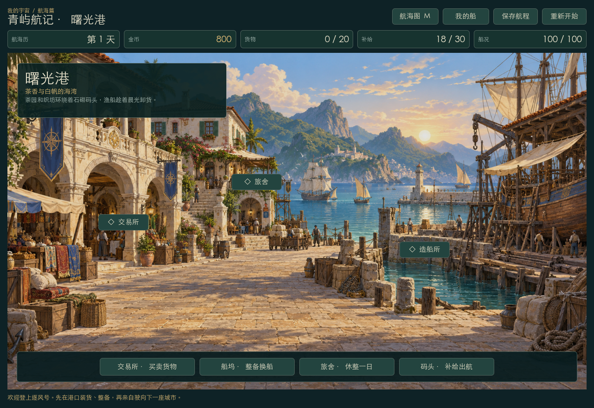
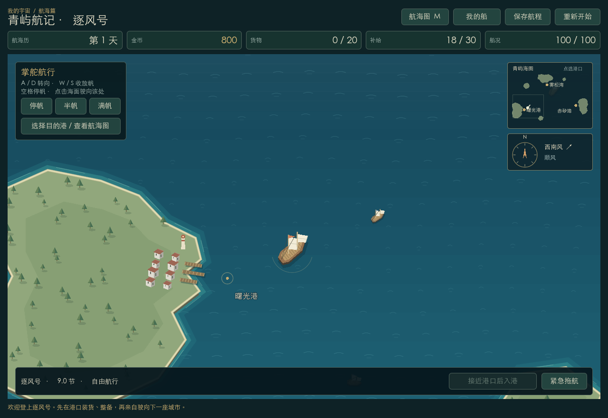

# 我的宇宙 · 青屿航记

独立 Godot 航海贸易 demo。当前 v2 聚焦航行、港口、贸易、船只：在连续海面上掌舵，在三座有独立绘景的港口补给和买卖，用收益整备自己的船。

## 运行

在 Finder 双击 `launch.command`。当前机器的项目本地 `.runtime/` 已准备 Godot 4.7.2 标准版，来源为 [Godot 官方发布](https://github.com/godotengine/godot/releases/tag/4.7.2-stable)，已核对官方 SHA512。该目录被 Git 和 Godot 资源扫描忽略。

已有 Godot 4 的机器可导入 `project.godot` 后按 F5 运行。实际验证版本为 4.7.2；默认入口为 `scenes/voyage.tscn`。

```sh
./launch.command
./launch.command --editor
GODOT_BIN=/absolute/path/to/godot ./launch.command

# 临时试玩，不读取或写入正式存档
./launch.command -- --test-mode
```

## 界面预览





预览由游戏实际渲染产生，可用 `./launch.command --script res://tests/render_previews.gd` 更新；该脚本不读取或写入正式存档。

## 第一趟航程

1. 从曙光港开始，拥有逐风号、800 金币、20 格货舱、18 份补给。
2. 点击绘景上的交易所，查看六种商品和目的港收购价。数量可输入，支持买入、卖出、买满、全卖。
3. 例如购买曙光港的茶叶，去码头选择雾松湾。先检查补给，也可以选择自由掌舵出航。
4. 自动航行会驶至港外并收帆；点击右下角「入港」进入当地城市。
5. 到交易所出售货物，再比较陶器、木材等返程货物。日期和库存会影响抵港价格。
6. 用收益在船坞修理、扩仓或购买更大商船，继续安排下一趟航程。

## 四部分玩法

### 航行

连续海面、随船镜头、岛岸浅滩、港口建筑、帆船与尾流。风向影响速度，船体存在加减速和转向过程。

| 操作 | 效果 |
| --- | --- |
| A / D，或左右方向键 | 手动转向，接管自动航行 |
| W / S，或上下方向键 | 收放帆：停帆、半帆、满帆 |
| 空格 | 收帆，逐渐减速 |
| 点击海面 | 驶向点击位置 |
| 点击小海图港口 | 自动驶向该港 |
| M / 航海图按钮 | 查看港口资料并设置目的地 |
| Esc | 关闭当前设施 |

自动抵达后仍停在海上，需主动入港。手动靠港要求接近港口并减速。触岸会停船，当前不产生碰撞损伤。打开设施或确认窗口会暂停航行和日期；海上停帆本身不会暂停日期。

### 港口

曙光港、雾松湾、赤砂埠分别采用暖色海湾、松林雾港、砂岩商埠绘景。可点建筑入口或底部设施按钮：

- 交易所：库存、买卖、持仓成本及异地行情。
- 船坞：船只信息、命名、修理、扩仓、换船。
- 旅舍：花费 20 金币休整一天，恢复 5 点船况；查看航程记录。
- 码头：补给、目的地航程提示、自动或自由出航。

### 贸易

六种商品为茶叶、陶器、香料、棉布、鱼干、木材。港口有各自优势商品和有限库存，价格随库存及七天周期小幅波动，每日库存逐渐补充。一次交易按点击前显示的单价统一结算，成交后更新行情。

收购价包含商会价差。累计交易利润按先入先出成本计算，尚未扣除补给、旅舍和船只整备等开支；它与金币余额是不同指标。异地行情显示当日报价，抵港时可能改变。

### 船只

| 船型 | 基础货舱 | 基础航速 | 船况上限 | 标价 |
| --- | ---: | ---: | ---: | ---: |
| 轻帆船 | 20 | 9.5 节 | 100 | 初始船 |
| 沿岸商船 | 38 | 8.5 节 | 140 | 1400 金 |
| 远洋商船 | 64 | 7.0 节 | 190 | 3600 金 |

船名可自定。400 金币可扩仓 10 格一次，改装随换船保留。旧船按标价一半折抵，换小船可能返还金币，但现有货物必须能装入新船。修理每点船况 1 金币。

补给使用独立补给仓，上限 30 份，每份 3 金币。海上每 12 秒经过一天，消耗 1 份补给；长期航行产生少量磨损，缺粮会加速损伤。船况为零后无法继续航行，可使用紧急拖航：返回上次港口、经过两天、最多支付 80 金币，保留货物并恢复最低航行条件。

## 存档

正常试玩会在交易、整备、出入港等操作后保存，也每 15 秒自动保存一次。窗口关闭会保存。下次启动自动继续，包括海上位置、朝向、自动航行目标、货物成本批次及港口库存。

文件是 Godot `user://voyage_v2.json`，可在 Godot 编辑器的「项目 → 打开用户数据文件夹」查看。当前 macOS 默认位于 `~/Library/Application Support/Godot/app_userdata/我的宇宙 · 青屿航记/`。

「重新开始」确认后重置航程并更新存档。若旧存档读取或校验失败，保留原文件并暂停写入，界面会提示；用户确认重开后恢复保存。测试及临时试玩不会改写正式存档。

## 本轮范围

剧情与探索内容、海战、势力竞争、船员系统和通用插件框架仍待后续讨论。本版为单船经营；三种船型目前共用海上船体绘制，性能与容量不同。港口采用静态绘景加设施入口，海上采用程序绘制，船坞使用简化船只示意图。

三张港口背景通过内置图像生成工具原创生成，完整提示词和素材路径见 [assets/ports/PROMPTS.md](assets/ports/PROMPTS.md)。本版没有复制《大航海时代 IV》的图片素材。

## 代码与验证

- `scenes/voyage.tscn`、`scripts/v2/voyage.gd`：新版入口、港口和设施 UI、交互与保存。
- `scripts/v2/sea_view.gd`：连续海面绘制、操船、镜头、自动航行与靠岸。
- `scripts/v2/game_state.gd`：贸易、船只、日期、补给及存档规则。
- `scripts/v2/ship_diagram.gd`：船坞示意图。
- `assets/ports/`：三张独立港口背景。

```sh
./launch.command --headless --script res://tests/v2_state_test.gd
./launch.command --headless --script res://tests/v2_ui_test.gd
./launch.command --headless --script res://tests/v2_navigation_test.gd
```

2026-10-14，Godot 4.7.2：状态规则 341 项、UI 集成 253 项检查通过；导航测试覆盖 6 个港际方向 × 4 个初始朝向，以及触岸保护、设施暂停和零船况禁航。原生窗口实际验证了买满茶叶、出航至雾松湾、入港切换绘景及出售获利，检查过市场、船坞、码头和海面布局。

v1 的固定航线原型仍保留在 `scenes/main.tscn`，可用 `./launch.command res://scenes/main.tscn` 打开进行对照；其代码和测试不参与新版入口。
