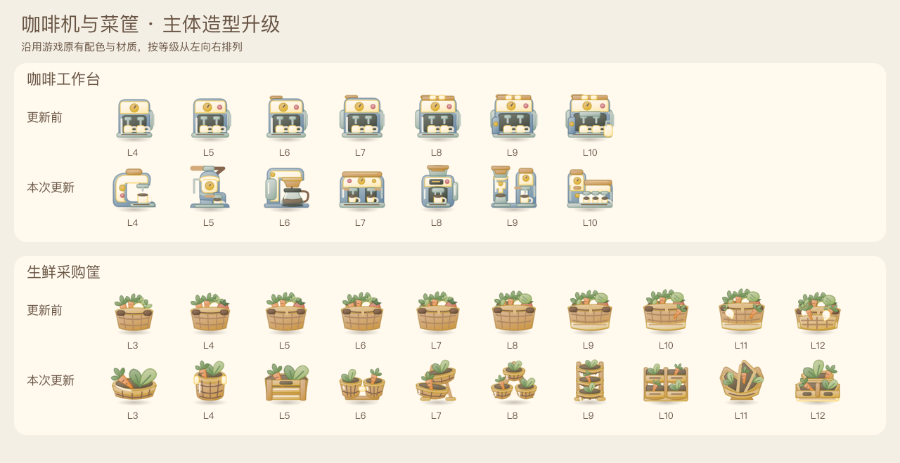

# 生产器升级主体差异（2026-10-16）

针对同类相邻等级在手机尺寸下过于接近的问题，重新设计全部76个启用设备等级。11类家族的既有颜色与材质保持，35个零件等级及33种来源容器保留。每级通过外轮廓、宽高比例、大开口和容器排列体现变化。

## 重点两条升级链

- 咖啡 L4–10：C形单杯机 → 压杆锅炉机 → 滴滤大壶机 → 横宽双头机 → 全自动豆仓机 → 分离双塔 → 阶梯三头咖啡站。
- 菜筐 L3–12：浅椭圆篮 → 深筒筐 → 宽木条箱 → 并列双筐 → 倾斜双层筐 → 三角三筐 → 窄三层架 → 双列四筐 → 扇形分仓菜台 → 低宽阶梯菜柜。

## 其他家族

原料罐有宽罐、高罐、双罐和分配罐；厨具使用分格缸、高低杯及阶梯收纳结构；香草盆采用长槽、双盆、立式和错层盆架；蒸笼区分单高、双浅、圆塔、双炉与阶梯蒸台；披萨炉区分宽低、细高、双口、层叠与多口拱炉；采购车从立式箱车、深斗、平板推进到多层和阶梯货厢；食谱架、花艺桶和循环桶也分别改变主体组合。

[11类111级全景](producer-tier-panorama.png) · [手机实机](producer-tiers-phone.jpg)

以上图片直接使用当前游戏的 `art.mjs` 输出。对照图的更新前一栏对应 `4d9d9ef`，没有经过AI重绘或改色。

## 实现与验证

`producer-art.mjs`仅负责目录校验与分流；35种零件仍由原模块输出。三个设备绘制模块只接受其支持的整数等级，未知家族和异常参数返回null。

- 108项现有测试、421项运行目录审计及全部模块语法检查通过。
- 独立复核111个SVG无非法数值或缺图；76个启用等级已替换，35个零件的输出与上一提交完全一致。
- 新模块全部颜色均来自旧生产器调色板，页面CSS、布局、物品ID、数值与存档逻辑没有变化。
- 已按真实材质检查100/80/50像素效果，含描边图形留在80×80图标的安全区域。
- 本地隔离场景 `?qa=producer-tiers` 展示全部咖啡/菜筐等级及其余家族入门和最高级；实测产出咖啡豆并扣减1电量，拖动合成L4→L5后出现对应机型，刷新结果保留。
- 320/390/430像素手机宽度下棋盘分别为292/352/392像素正方形，无横向溢出。控制台未观察到警告或错误。
