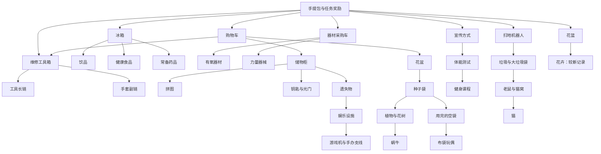

# 肥鹅健身房：物品与数值参考研究

研究截至：2026-10-16。用途：为“小厨合合”提供可追溯的合成经营设计参考。

## 1. 结论与资料范围

肥鹅的核心系统由“生产器成长、普通二合一、多产物分流、跨链生产、订单建设、空间约束、资源合成、辅助道具”共同构成。设计的关键在于完整供给网络，以及能量、冷却、空间三个成本的组合。

本研究整理了40个主棋盘或历史物品系列、资源与道具参数、代表性活动关系。完整逐级名称、数字和未知项分别见 [物品证据表](FEIGE_ITEMS.md)、[数值证据表](FEIGE_NUMBERS.md)。机器可读数据见 [feige-reference.json](feige-reference.json)。

公开检索没有找到开发者发布的现版全量配置、完整掉率表、全部生产器库存/冷却、升级经验曲线与所有订单奖励算法。因此本研究保留缺口；这些缺口只能通过指定渠道、指定版本的实机采样或开发者配置补齐。

本轮重新访问官方入驻页（页面版本5.9.1、2026-06-03），复核2022实机主棋盘图，并打开2023原始库存表附件。G/H/K列分别可辨为周期、周期补量、总容量；I列回满时间与单周期分开。已将能辨认字段接入小厨，冲突和未证实部分按字段处理：[决策表](ALIGNMENT_PARAMETERS.md)、[稳定ID表](ITEM_REFERENCE_MAP.md)。公开资料仍不能确认2026所有渠道的统一配置。

## 2. 证据等级和版本

| 标记 | 含义 | 可以如何使用 |
| --- | --- | --- |
| O | 官方公告中明确写出的事实 | 使用公告明确覆盖的日期与范围 |
| P | 玩家图鉴、截图、攻略或视频记录 | 连同地区、时间、版本风险引用 |
| U | 未取得可核对资料 | 保存为null，不能解释为0或不存在 |
| D | 小厨自行拟定的设计值 | 只出现在小厨方案中，不回填肥鹅事实表 |

“截图确认了某物品存在”和“截图证明了当前最高等级”是两种证据。名称出现在订单中，也不能证明它在合成链中的等级。

主要版本事件：

| 时间 | 事件 | 对研究的影响 |
| --- | --- | --- |
| 2022年早期 | 攻略使用装修工具箱、红车、砖头、油漆及花篮奖杯链 | 仅保存为历史拓扑 |
| 2022年后期 | 玩家记录红车变为冰箱、花篮产物调整 | 两套美术/主题不能重复算成现版新增链 |
| 2023-06-30 | 官方增加饮品11级、体能测试5/6级，并增强部分主发射器 | 旧版“饮品10级、测试4级最高”失效 |
| 2024—2025 | 玩家记录购物车及部分发射器扩级、双倍按钮等变动 | 旧等级上限与效率表不能直接复用 |
| 本次检索 | 官方入驻页显示5.9.1及2026-06-03更新记录 | 只能说明页面展示，不能保证所有渠道和热更新一致 |

来源：[官方更新](https://www.taptap.cn/moment/423905649257087137?group_id=322770)、[玩家改版记录](https://www.taptap.cn/app/232158/review?os=android&page=2)、[生产器扩级记录](https://www.douyin.com/user/MS4wLjABAAAAY6JWg7d_GHyFPSfRS3776OAg0FYcwHkoG12mn8Yv0vU)、[官方入驻页](https://www.taptap.cn/app/232158)。

## 3. 元素类型

| 类型 | 行为 | 代表 |
| --- | --- | --- |
| 生产器零件 | 同级二合一，达到指定等级才生产 | 工具箱把手、车轮、塑料板 |
| 长期主动生产器 | 消耗能量，库存用尽或不足时受冷却限制 | 工具箱、冰箱、器材采购车 |
| 自动生产器 | 等待后产出，受周围空格限制 | 花树、储物柜、部分遗失物 |
| 有限生产器 | 固定或有限次数，耗尽消失/留下另一物品 | 种子堆、部分游戏机环节 |
| 状态阶段 | 生产操作使同一物体进入下一状态 | 旧手办支线中的墙壁/野餐篮 |
| 普通合成物 | 两个同类同级变为下一等级 | 维修工具、饮品、有氧器材 |
| 功能转换节点 | 达到某级后开启另一产物链 | 大型失物篮、大垃圾袋、花树 |
| 资源容器和资源 | 可开启或合并后兑换余额 | 手提包、存钱罐、能量、金币、钻石 |
| 辅助道具 | 改变时间、库存、等级或空间 | 加速、充能、剪刀、升级卡、背包 |

这些是便于设计分析的分类。一个物品可以同时是合成物和生产器。[玩法分类记录](https://forum.gamer.com.tw/C.php?bsn=77871&snA=35)

## 4. 主棋盘生产网络

图中箭头表示来源关系，可能跨越多个合成等级。它不表示任意相邻两个名字都能直接二合一。

主要来源：[原始玩家攻略](https://www.taptap.cn/moment/260763709427681258?group_id=322770)、[初始图鉴](https://www.gamedog.cn/games/a/3257892.html)。图中的“手提包与任务奖励”是来源集合，不表示每一种手提包都会掉全部生产器。

### 4.1 直接订单链

维修工具是较长主链，手套是较短副链。冰箱有三类产物，器材采购车有有氧与力量两类产物。副产物的成本取决于其概率以及能否同时利用主产物，不能只按等级定价。

例如，若两个物品同为4级，但一个品类出现概率80%，另一个出现概率10%，在同一产物等级分布下，单独追求后者的平均点击需求约为前者的8倍。80%/10%仅为本节数学示例的假设概率。

### 4.2 遗失物—娱乐—手办

已核实：遗失物1—6级；5级大型失物篮与6级失物招领处可产U型枕；娱乐设施前段依次为U型枕、枕头、按摩器、筋膜枪、随身听。完整的后段见证据表。[逐级图鉴](https://www.taptap.cn/moment/431855084888916076)

旧手办路径存在“NS→墙壁→游戏材料→尼德霍格→肥鹅精灵”记录；台服记录把中间环节写作野餐篮。它们必须作为两个版本样本存档，不能混合成统一配方。[大陆旧路径](https://www.sohu.com/a/638585093_121631443)、[台服路径](https://forum.gamer.com.tw/C.php?bsn=77871&snA=67)

### 4.3 植物—蜗牛与空袋—布偶

种子袋的4级为种子堆；植物链为种子、温室花苗、花苗、绿植、发财树、花树。花树再产蜗牛起始物。空袋要在种子用尽后取得，两个4级空袋才跨入布袋玩偶系列。[植物记录](https://www.sohu.com/a/638585093_121631443)、[空袋转换说明](https://www.youxi369.com/gonglue/126585.html)

这体现同一投入产生两条用途：种子用于植物，耗尽容器用于布偶。制作空袋支线时，种子副产品的处理也会占用空间。

### 4.4 垃圾—老鼠—猫

扫地机产垃圾，合至大垃圾袋后自动产生老鼠，老鼠继续通向猫窝，猫窝产猫。完整链需要同时管理点击成本、等待时间和棋盘空间。[猫来源记录](https://www.9game.cn/news/9650029.html)

### 4.5 拼图与钥匙

拼图图鉴可核对到13级珍藏照片。13级由4096个一级等价组成，因此它自然成为长期收藏目标。这里的4096只反映二合一关系，不等于4096体力；实际来源可能是其他发射器副产物或自动产物。[拼图截图与记录](https://www.9game.cn/news/9982361.html)

## 5. 可引用的数值锚点

| 数值组 | 本次记录 | 应用边界 |
| --- | --- | --- |
| 普通合成 | 2个同类同级→1个下一级 | 投料、耗尽、状态变化另外建规则 |
| 普通点击 | 通常消耗1点能量 | 特殊/活动节点单独确认 |
| 自然恢复 | 120秒/点 | 2024攻略记录，现版需实测 |
| 金币道具 | 1、3、8、20、50、120 | 2023台服记录 |
| 钻石道具 | 1、3、8、20 | 2023台服记录 |
| 能量道具 | 1、6、15、40、100 | 2023台服记录；低级数值存在其他文本冲突 |
| 黑包次数 | 10、22 | 未使用容器的2023历史记录 |
| 粉包次数 | 12、28 | 同上 |
| 存钱罐次数 | 15、18、53 | L1已用可合并有S12原始记录；已用L2的完整继承公式仍未知 |
| 无限能量 | 30、60、120、300秒 | 2025转载玩家记录 |
| 棋盘加速 | 1、2、4、8、16小时 | 2025转载玩家记录 |
| 充能 | +5、+10、+20库存 | 超容量规则未知 |

来源：[资源档位](https://forum.gamer.com.tw/C.php?bsn=77871&snA=66)、[体力恢复](https://shouyou.3dmgame.com/gl/522320.html)、[容器历史次数](https://www.sohu.com/a/635390261_121631443)、[辅助道具](https://www.yeyulingfeng.com/214916.html)。全部参数和限制另列于 [数值证据表](FEIGE_NUMBERS.md)。

## 6. 数学模型：用于理解和小厨建模

以下公式是分析方法；未宣称来自肥鹅代码。

### 6.1 二合一的等价量

`B(L)=2^(L−1)`。

| 物品等级 | 1 | 2 | 3 | 4 | 5 | 6 | 7 | 8 | 9 | 10 | 11 | 12 | 13 | 14 |
| --- | --- | --- | --- | --- | --- | --- | --- | --- | --- | --- | --- | --- | --- | --- |
| 一级等价 | 1 | 2 | 4 | 8 | 16 | 32 | 64 | 128 | 256 | 512 | 1024 | 2048 | 4096 | 8192 |

### 6.2 多品类、多等级的平均产出

令 `q_f` 为目标品类概率，`p_l` 为产物等级概率，`μ=Σp_l×2^(l−1)`。目标为该品类L级物品时，长期平均点击近似为 `B(L)/(q_f×μ)`。有限样本会有超额产物和剩余碎片，精确期望需动态规划或模拟；不能把这个近似当玩家必然消耗。

如一台设备同时提供两个目标品类，两条目标的点击不应直接相加。最基本的估算下界为各品类需求点击的最大值，实际还受随机波动、等级余料和空间影响。

### 6.3 资源合成溢价

资源的领取价值往往大于两个低级价值之和，以奖励暂存和合并。例如台服记录中，两个3金币物品合成后领取8金币，而两个8金币合成后领取20金币。增益与棋盘占格形成取舍。

生产器的参数至少需要五项：每次耗能、品类概率、等级概率、补货间隔、最大库存。自动生产器还需邻格/缓冲规则；有限生产器还需剩余次数继承规则。只有“冷却30分钟”不能推导完整产能。

## 7. 活动系统边界

| 活动 | 已见结构 | 本次可用内容 |
| --- | --- | --- |
| 创始鹅之谜 | 蜡烛与蛋糕、音乐盒等支线、活动经验、雕塑奖励 | 仙人掌900秒/8次、打火机1800秒/16次且可存两轮、数字9售价410的历史记录 |
| 新春贺岁 | 采购、蔬菜、荤菜、厨具、年货 | 蔬菜7级、厨具6级的历史名称链 |
| 露营吧肥鹅 | 露营设施提供食材/餐具，烤炉投料，花圈产萤火虫 | 用于投料和降级状态机参考 |
| 健康餐大作战 | 菜篮、制冰机、和面机、电冰箱、锅、榨汁机、配送 | 用于明确的多材料料理配方参考 |

新春蔬菜：胡萝卜→玉米→土豆→青椒→蘑菇→黄瓜→蔬菜拼盘。厨具：锅铲→擀面杖→量米杯→围裙→砧板→大锅。[新春图鉴](https://www.sohu.com/a/631887650_121631443)

健康餐有“面团+虾仁→虾仁荞麦面”这样的配方，活动投料需独立定义。主棋盘食品链仍遵循同物二合一。[健康餐](https://forum.gamer.com.tw/C.php?bsn=77871&snA=217)、[露营](https://forum.gamer.com.tw/C.php?bsn=77871&snA=191)

未取得历年活动全量配置。本包不将活动次数、售价、奖励跨到常驻主棋盘，也不将活动元素计入40个主棋盘/历史系列。

## 8. 需要实机补证的清单

| 优先级 | 缺口 | 采集方法与验收 |
| --- | --- | --- |
| P0 | 渠道、地区、客户端版本和热更新日期 | 每个样本在同一记录中保存这些字段，禁止混样 |
| P0 | 每类生产器全部等级、产物概率、库存、冷却 | 拍完整物品页；从满库存点击至耗尽；记录恢复和堆积上限；按等级独立采样 |
| P0 | 高阶物品名称和链长 | 每条链完整图鉴截图，名称页与等级对应 |
| P0 | 部分使用容器的合并规则 | 对照未用、部分使用、最后一次前合并的独立样本，避免旧攻略技巧误导 |
| P1 | 订单完整输入、奖励、刷新条件 | 按玩家等级、建设阶段记录，不从少量订单拟合唯一公式 |
| P1 | 仓库扩容、玩家经验、钻石补体力价格 | 连续等级/购买序号记录，标明每日重置时点 |
| P1 | 自动生产与离线、满盘关系 | 在线空盘、满盘、仓库、离线分别验证 |
| P2 | 限时活动全量元素及返场差异 | 按活动ID和期次独立归档 |

概率采样建议先做每类设备每等级1000次以上的探索，再按低概率分支扩大样本；必须报告样本数和区间，不把频率写成官方精确概率。该建议是采样方案，尚未执行。

## 9. 对小厨的直接设计约束

- 保留同物二合一，以及少量有明确UI提示的跨链转换。
- 生产器采用零件成长和分等级产能，而非所有设备都只有四个相似等级。
- 主链、副链、自动链、容器回收链分别定价和配置。
- 订单要求和实际来源绑定；长收藏支线不堵住基础经营。
- 把能量、时间、格子视为不同成本；商品不能形成无上限的即时兑换获利循环。
- 公开未知参数由小厨单独定义并验证；逐项的继承和适配见 [小厨目标设计](KITCHEN_BALANCE.md)。
