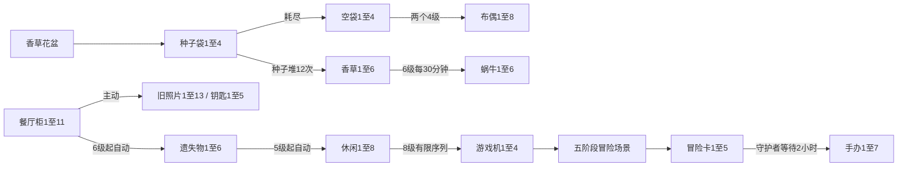

# 小厨合合：完整物品与数值设计 v1

日期：2026-10-16。设计来源状态：`DESIGN_ONLY_NOT_RUNTIME`。历史设计基线：Git `fdd3acf`。本配置现已接入默认游戏，实际接入与验证见[实现说明](../BALANCE_IMPLEMENTATION.md)。

本方案以肥鹅的二合一、生产器零件、多产物分流、有限容器、自动支线、资源合成和订单建设为框架，为小厨补齐常驻经营的物品、供给、消耗、奖励和存档规则。共64个系列、421个物品定义、11类主生产器、21条特殊转换、12章96个主线订单、10道料理配方。

肥鹅公开证据覆盖的部分按来源引用；未公开的掉率、冷却、奖励公式及全部小厨原创配置标为 **D：项目拟定**。这里的“完整”指本版小厨设计范围内的闭合配置；肥鹅现版私有配置仍有研究缺口，见 [参考研究](FEIGE_REFERENCE.md)。

## 1. 文档、数据与实现边界

| 文件 | 用途 |
| --- | --- |
| [当前数值快照](KITCHEN_CURRENT_BASELINE.md) | 当前实际运行的77种图鉴物品、7类四级生产器、10道配方 |
| [目标物品全表](KITCHEN_ITEMS.md) | 每一级名称、ID、合成目标、等价量、售价或领取值 |
| [生产器全表](KITCHEN_PRODUCERS.md) | 每一级库存、补货周期、品类与等级概率；特殊状态机 |
| [章节、订单与配方](KITCHEN_ORDERS_RECIPES.md) | 逐单需求、金币、经验、星星及烹饪成本 |
| [经济与等级奖励](KITCHEN_ECONOMY.md) | 全局数值、商店、容器、扩容和2—100级奖励 |
| [目标JSON](kitchen-target.json) | 机器可读设计数据，导入实现前须编写适配层 |
| [数值审计](VALIDATION.md) | 静态检查、可达性与概率抽样，及仍需试玩验证的节奏 |

标量与表格以 `build_docs.py` 生成的JSON为准，交互、状态继承与迁移以本文为准。发生冲突必须修订设计后再实现。默认 `dist/` 已接入本配置并支持v3迁移；线上部署不在本次交付范围。农牧、餐车和限时活动遵循 [庄园扩展计划](../MANOR_ROADMAP.md)，另行设计其独立配置。

## 2. 参考映射与物品类型

### 2.1 逐组适配

| 肥鹅结构 | 小厨对应 | 继承/适配 |
| --- | --- | --- |
| 维修工具箱→工具长链、手套副链 | 厨具收纳箱→14级厨具、3级隔热手套、8级餐具 | 工具长链和短副链；保留项目已有餐具 |
| 器材采购车→有氧/力量器械 | 烘焙食材篮→11级烘焙、7级烘焙器具 | 长主链与副链；副链7级为D |
| 冰箱→食品/饮品/药品 | 生鲜采购篮→8级蔬菜、8级水果、4级保鲜 | 三品类结构；咖啡继续由原工作台供应 |
| 饮品扩至11级 | 11级咖啡链 | 长度取历史更新锚点，名称沿用厨房主题 |
| 花盆→种子袋→植物→蜗牛 | 香草花盆→4级种子袋→6级香草→6级蜗牛 | 末端自动生产；原香草1—6级名称保留 |
| 种子用尽→空袋→布袋玩偶 | 4级空种子袋→8级手作布偶 | 两个最高级空袋跨链转为布偶起点 |
| 购物车→主生产器零件、储物柜 | 设备采购车→设备零件、11级餐厅储物柜 | 自生产及其他设备零件循环 |
| 储物柜→拼图、钥匙、遗失物 | 储物柜→13级旧照片、5级钥匙、6级遗失物 | 手动与自动产出并存 |
| 失物→娱乐→游戏机→场景→手办 | 遗失物→8级休闲→4级掌机→5个场景阶段→5级冒险卡→7级手办 | 使用统一的小厨状态机，次数与名称为D |
| 钥匙→神秘光门 | 感应手环→6级旧日记忆 | 有限产出后消失 |
| 宣传方式→体能测试→健身课程 | 食谱研究台→6级试菜评估→6级烹饪课程 | 4级开始有限生产，保留高阶合成选择 |
| 花篮→花卉 | 花艺工具篮→9级餐桌花艺 | 采用较新花卉方向，9级为D |
| 扫地机→垃圾→老鼠→猫窝→猫 | 循环箱→8级堆肥→6级花园来客→8级猫咪 | 厨房园艺主题；末端继续生产 |
| 冠军之路/奖杯 | 7级主厨荣誉 | 改为12章通关后的永久订单里程碑 |
| 能量、金币、钻石、包、加速道具 | 对应资源与辅助道具 | 已知历史档位引用；使用约束和掉率为D |
| 小厨原有世界菜系与配方 | 中式、日式、意式、墨西哥、10道食谱 | 保留66个原普通物品的ID及名称，扩展等级 |

参考证据逐组见 [肥鹅物品表](FEIGE_ITEMS.md) 与 [来源登记](SOURCES.md)。映射表示机制关系；原物品名称和素材不直接用于小厨美术。

### 2.2 数据类型

普通同级二合一使用 `mergeTo`；生产器零件也使用这条规则。`hybrid` 表示同时承担合成和生产功能。`stateful` 的五个冒险场景按耗尽次数转场，`mergeTo=null`；它们的序号表示阶段，不能当普通等级。资源是否可合并以每个条目的 `mergeTo` 为准；两类升级卡是独立道具，不能互相合成。

`legacy_*` 的11项仅供旧档兑现，不进入新掉落和新玩家图鉴完成率。421项还包含生产器零件与场景阶段，不能把421直接理解为普通菜品数。

每个实例至少保存：`instanceId、itemId、createdAt、location、stock、stockOverflow、nextRechargeAt、autoBuffer、remainingDraws、sequenceIndex、openedAt、timerRemaining、protected、sourceVersion`。未使用的状态字段取null。多模式载体如储物柜分别保存主动库存和自动计时，不能共用一个CD。

## 3. 全局与空间

| 项目 | 目标值/规则 | 依据 |
| --- | --- | --- |
| 棋盘 | 7×7，49格；初始底部14格锁定 | 保留项目 |
| 初始余额 | 120金币、20钻石、100体力、0星星、0XP | D |
| 初始设备 | 首个可生产等级的食材篮、厨具箱、生鲜篮各1台，位置0、3、6 | D；保留现版位置 |
| 初始其他物品 | 保留快照中的普通物品及位置；待领订单礼盒L1×1 | D |
| 初始辅助道具 | 万能剪刀×2、大补货箱×2 | D |
| 自然体力 | 120秒恢复1点，上限100；从0到满需200分钟 | 参考历史120秒锚点 |
| 手动补能上限 | 999；超过部分存入待领补能额度 | D |
| 生产耗能 | 主动有效产出1件消耗1点；包/资源领取0点；配方单独计价 | D |
| 仓库 | 初始6格，上限60；一次购买+2，赠格也计入容量 | 保留空间尺度，价格重设 |
| 锁格金币 | `12+floor(index/7)×4`，底部两排32/36金币 | 保留项目 |
| 时间边界 | 北京时间每日0时；周任务每周一0时 | D |
| 玩家等级 | 1—100；超出满级所需经验继续记录，不再发等级奖励 | D |
| 余额边界 | 金币/钻石/星星单余额上限10亿；溢出进待领额度 | D |

同物合并可以打开被锁物品格；紧邻成功合并的位置可以打开锁定空格，保留现版行为。锁定物品不能生产、出售或交单。空间不足时拒绝普通生产及需要额外格子的操作，体力、库存、道具和随机序列均不变。任务、礼物及一次性转换的多件奖励放入待领队列，领奖成功后原子扣除队列记录。

仓库中的生产器、种子堆、场景和倒计时物暂停；待领区也暂停。移动入仓先结算截至移动时刻的产出，再保存剩余计时，取出后接续。自然体力、钻石购体力次数和账号级无限体力计时不受入仓影响。

## 4. 主生产器成长与掉率

### 4.1 统一模型

主生产器共11类，各自先合并零件，到启用等级后生产。定义有效阶 `r=当前等级−启用等级`：

- 一轮补货量依次为 `12、16、20、26、34、44、56、72、90、112`，总库存为两轮。
- 补货周期为 `ceil(首阶周期×(1−0.05r))` 秒，具体等级已展开在生产器表。
- 每次先按品类概率抽取系列，再独立按该阶的L1/L2/L3概率抽取等级。
- 等级概率依次为 `100/0/0、90/10/0、80/20/0、65/30/5、55/35/10、45/40/15、35/45/20、25/45/30、15/40/45、10/30/60`（百分比）。
- 所有概率、库存和CD为D。高阶产物的增长和库存增长共同决定设备价值。

| 设备 | 启用/最高级 | 首阶周期 | 产物概率 |
| --- | --- | --- | --- |
| 厨具箱 | 4/12 | 10分钟 | 厨具80%、隔热手套12%、餐具8% |
| 食材篮 | 5/11 | 15分钟 | 烘焙90%、烘焙器具10% |
| 生鲜篮 | 3/12 | 10分钟 | 蔬菜62%、水果28%、保鲜10% |
| 咖啡台 | 4/10 | 10分钟 | 咖啡100% |
| 香草花盆 | 4/10 | 15分钟 | 种子袋100% |
| 亚洲台 | 4/10 | 20分钟 | 中式72%、日式28% |
| 环球台 | 4/10 | 20分钟 | 意式72%、墨西哥28% |
| 设备采购车 | 4/12 | 4小时 | 柜子50%、花盆零件20%、厨具箱零件15%、采购车零件5%、花艺篮零件10% |
| 食谱研究台 | 4/6 | 1小时 | 试菜评估85%、自身零件15% |
| 花艺篮 | 5/9 | 30分钟 | 花艺100% |
| 循环箱 | 5/9 | 30分钟 | 堆肥100% |

设备采购车最早第6章出现，花艺第7章解锁。产物中的未解锁系列按章节过滤并对剩余概率归一化；表格写的是全部解锁后的原始权重。手提包采取同样规则。这条过滤会改变早期实际概率，不能在计算中继续使用未过滤权重。

### 4.2 库存、离线和升级继承

设备发放时为满库存。库存第一次低于上限时启动补货，每到一次CD增加一轮，钳制至上限；满库存时计时停止。持续点击期间补货时钟继续走。离线按经过的完整周期补货，最多存两轮，超出时长不形成隐藏库存。首次从满库存扣除后重新开始计时。

同级设备合并时，库存相加；超过新设备上限的存为 `stockOverflow`，优先使用。溢出用尽前停止自然补货。剩余冷却使用两台设备中较慢的归一化剩余比例乘新CD；满库存设备的比例按1计。合并不会重置为满库存。零件升级到首次启用的设备初始库存0，从完整CD开始补货；章节直接赠送设备使用满库存。

升级卡将原库存、溢出和归一化CD迁移到新等级，不凭空补货。所有产出先验证可落格，再持久化抽奖与扣费事务；刷新网页不能重新抽取同一次操作。时间回拨按0经过处理，保存最后结算时间。单机版无法防止用户主动修改本地存档，这属于运行环境边界。

## 5. 特殊路径和状态机

| 转换 | 完整行为 |
| --- | --- |
| 种子堆 | `seedbag:4`点击12次，每次1体力得`herb:1`；最后转为`emptybag:1` |
| 空袋跨链 | 两个`emptybag:4`合成`doll:1`，不另耗能 |
| 香草末端 | `herb:6`每1800秒产蜗牛L1，缓冲上限2 |
| 储物柜 | 所有1—11级可点击：一轮8、总库存16、1800秒补货；旧照片80%、钥匙20%；6级起另每1800秒产遗失物L1，缓冲2 |
| 遗失物 | L5每3600秒、缓冲2；L6每2400秒、缓冲3；均产休闲L1 |
| 休闲L8 | 12次固定序列：旧照片L1、旧照片L1、游戏机L1，重复4轮；每次1体力，用尽消失 |
| 游戏机L4 | 点击3次，各产冒险场景阶段1，每次1体力；用尽消失 |
| 冒险场景 | 五阶段分别产8/10/12/14/16张冒险卡L1，每次1体力；耗尽进下一阶段，末阶段后消失 |
| 冒险卡L5 | 放在棋盘开始7200秒计时；完成后消失并发4个手办L1进待领队列 |
| 钥匙L5 | 4次各产旧日记忆L1，每次1体力，用尽消失 |
| 试菜评估L4/L5/L6 | 分别4/8/16次产课程L1，每次1体力，用尽消失 |
| 堆肥L8 | 每1800秒产花园来客L1，缓冲2 |
| 花园来客L6 | 猫窝，一轮20、总库存40、7200秒补货，点击1体力产猫咪L1 |

以上21条规则的字段见 [特殊转换表](KITCHEN_PRODUCERS.md)。储物柜等级提升目前只增加一级等价与自动功能；其主动产能不随等级继续增加，这是D版的明确选择。

自动产出优先放到四邻未锁空格；无空格存入内部缓冲，缓冲满后暂停时钟，不追溯补产。清出邻格时先释放缓冲，再从暂停的时点继续。离线时只补满内部缓冲，回到棋盘再落格，避免离线扩散。自动载体合并前须把缓冲转到待领队列；新载体使用较慢的归一化剩余时间，升级卡同理。合并两实例的秒表timeCredit相加保留，超120小时部分也保留但不再接受新秒表，消耗至上限内后恢复使用。

有限物品首次点击/开始计时时标记已开启；已开启物品禁合成、禁剪、禁升级。未开启的最高级有限载体可以交单或执行明确的转换。最高级种子堆、试菜评估、休闲礼盒等在点击前提供“生产”操作，拖动仍按合成/交单处理；五个场景只显示剩余次数与阶段。

永久生产载体默认保护、售价0；任何交单或消耗不得拿走某条已解锁供给链的最后一台可生产设备。厨具也保护当前已解锁配方所需的最后一个合格工具。可用高阶替代时按最低够用工具参与判断；未使用的有限载体不被当成永久供给保障。

## 6. 定价模型与10道配方

普通二合一的一级等价为 `B=2^(L−1)`。所有等级的B已列入物品表。标准定价权重为 `C=B×w`，按物品保留3位小数后求订单总和。

直接链 `w=1/首阶完全解锁后的品类概率`。例如食物1.111111、蔬菜1.612903、水果3.571429、餐具12.5。设备升级提高效率，但订单C不随玩家设备等级降低。C用于统一定价；库存等待、共用副产物和有限样本余料另外计算。

| 间接链 | 每个一级等价的w | 定义 |
| --- | --- | --- |
| 香草 | 20/12 | 8次产种子包+12次开种子堆，得到12个香草L1 |
| 空种子袋 / 布偶 | 20 / 320 | 不给香草副产物抵扣的整批采购口径 |
| 蜗牛、遗失物、休闲、冒险卡、花园来客 | 4 | D：等待与空间定价权重 |
| 游戏机 / 手办 | 128 / 32 | D：多段转换定价权重 |
| 旧照片 / 钥匙 | 1.25 / 5 | 柜子主动80%/20%掉率 |
| 旧日记忆 / 课程 / 猫咪 / 荣誉 | 40 / 7.5 / 5 / 64 | D：转换或长期收集权重 |

间接链的w不等于精确边际体力。自动源建设成本的分摊、试菜评估分级开启策略会改变真实成本；这些支线只进入固定主线和收藏，不进入无限重复订单池。储物柜本身定价权重2来自采购车50%权重，物品不能出售。

10道旧配方保留材料数量、输出与厨具最低等级。烹饪耗能为 `ceil(max(0,0.9×输出C−输入C))`，金币0、重复制作XP0；厨具保留。获得新物品首次图鉴发现另记1XP。完整表已逐道展开，不需要策划临时算值。

例如现版沙拉和拿铁用3个一级等价产出8个一级等价；目标加入上述能量补差。配方提供最高约10%的标准成本优惠，取整可能让实际优惠更低。所有配方输出1件且不提供反向拆料；剪刀仅拆普通同系列等级，消耗道具。工具的取得成本属于长期设备成本。

## 7. 主线、重复订单与等级

### 7.1 十二章

每章8个固定订单按序完成，完成全部订单并支付该章星星才装修结算。已付费章节只结算一次。主线单独占1个UI位置；重复订单保留3槽。首章设备随新档发放，后续设备由上一章结算赠送首次可生产级，保证章节内来源已解锁。

| 当前章 | 星星支出 | 结算后解锁 |
| --- | --- | --- |
| 1 布置咖啡角 | 3 | 咖啡台 |
| 2 种下窗边香草 | 5 | 香草花盆 |
| 3 开设亚洲料理台 | 7 | 亚洲台 |
| 4 迎接环球美味 | 9 | 环球台 |
| 5 扩建陶瓷储藏间 | 11 | 设备采购车、餐厅储物柜L6 |
| 6 布置花园餐桌 | 13 | 花艺篮 |
| 7 升级主厨工作室 | 15 | 食谱研究台 |
| 8 开业！梦幻小厨房 | 18 | 循环箱 |
| 9 找回开店旧照 | 24 | 后续花园任务 |
| 10 迎接花园来客 | 30 | 后续课程任务 |
| 11 筹办主厨课堂 | 36 | 终章任务 |
| 12 举办邻里美食节 | 45 | 荣誉L1与永久荣誉里程碑 |

合计216星。本章主线星星合计为 `max(8,本章支出)`，全部主线自足；重复订单提供额外进度选择。保留旧8阶段的仓库赠格、礼盒、金币奖励，具体数量见章节表。旧装修名继续用于章节标题；“开设/布置”描述这一章完成时获得的设施。

96个订单是确定的v1任务配置，名称可由后续文案替换。第6章开始有自动产出等待；第10章猫窝需要累计32个花园来客L1。仅1台堆肥箱且持续清空缓冲时，32次30分钟产出就需16小时，另有上游建造时间。第12章手办也包含2小时成熟等待。这些章定位为多次回访任务，当前静态审计不能证明实际通关天数。

### 7.2 重复订单算法

1. 候选仅包含烘焙、蔬菜、水果、咖啡、餐具及四个国家菜系；排除厨具、香草、资源、设备和长支线。来源必须已解锁，且存在棋盘上的可用源，或仓库源可在棋盘至少1个空格时取出。暂时处于CD也算可用，待领源不算。
2. 三槽基础C区间为易 `[3,12]`、中 `[12,32]`、长 `[32,80]`。乘各章系数 `1,1,1.25,1.5,2,2.5,3,3.5,4,4.5,5,6`。
3. 各章最高物品等级为 `3,3,4,4,5,5,6,6,7,7,8,8`。一单1—2种不同物品，每种1—2件；三槽合计最多3个普通品类。完全相同的需求组合不同时出现在两个槽位。
4. 枚举满足约束的需求组合，在成本区间内均匀抽取。无候选时，允许降到区间下限以下，选不超过上限的最高成本候选；仍无候选则留槽空缺并提示取出设备，不凭空发一个无来源任务。记录降档原因用于调参。
5. 奖励 `金币=ceil(8+2C)`、`XP=ceil(4+C/4)`、`星星=min(4,max(1,ceil(C/40)))`。接单生成时冻结要求和奖励，升级设备不重算。
6. 每日3次免费刷新，之后每次50金币，每日最多刷新10次，额度全槽共用；替换后不奖励、不计交单数。无可用替换候选时不扣次数/金币。

所有正式交单都计章节外每日/每周委托；主线也计数。订单礼盒计数要求C≥4，每5个合格订单给礼盒L1，每日最多3个。当天已满上限后的订单不预存到下一天；未完成的一轮计数跨日保留。荣誉里程碑在12章完成后开始独立累计，每10个C≥4的订单给荣誉L1。

### 7.3 经验

L升L+1所需XP为 `100+20×(L−1)`；达到等级L的累计XP为 `100(L−1)+10(L−1)(L−2)`。订单为主要经验源；每个物品首次图鉴发现给1XP，重复合成给0XP。2—100级逐级奖励全部列于经济表，以 `levelRewardClaimed` 防重。

每级给能量补给箱1个；逢10级给高级黑包、高级粉包和一小时棋盘沙漏；尾数5的等级在黑/粉L1之间交替，5级黑、15级粉。每15级额外给30秒无限体力、每20级普通升级卡、每25级扩容包，50和100级额外给设备升级卡。条件可叠加。

## 8. 资源、经济和商店

### 8.1 资源合成

| 资源 | 从L1到最高级领取值 | 依据 |
| --- | --- | --- |
| 体力 | 1、6、15、40、100 | 2023台服记录S14 |
| 金币 | 1、3、8、20、50、120 | 同上 |
| 钻石 | 1、3、8、20 | 同上 |
| 黑包 | 10、22次 | 历史攻略S16 |
| 粉包 | 12、28次 | 同上 |
| 存钱罐 | 15、18、53次 | 同上 |

资源领取0体力。金币/钻石/体力物可以先合并再领取；最高档分别对应120金币、20钻石、100体力。未开黑/粉包、存钱罐、订单礼盒可同级合成；开始开锁或取过物品后禁止合并。能量补给箱单级，每箱5次，不能合成。领取容器最后一次后消失。

黑包掉设备零件权重：厨具箱35%、花盆25%、采购车20%、花艺篮20%；粉包：食材篮20%、生鲜篮20%、咖啡台15%、亚洲台15%、环球台15%、研究台7.5%、循环箱7.5%。按打开时已解锁设备过滤归一化，冻结该包的抽取池；零件L1/L2/L3概率65%/25%/10%。黑包L1/L2开锁600/1800秒，粉包900/2400秒；开锁后点击取物不耗能。

存钱罐先抽金币90%/钻石10%，再抽等级。L1罐的L1/L2/L3概率90%/10%/0%；L2罐45%/40%/15%；L3罐35%/45%/20%。这些概率是D，已按罐等级区分，合罐收益见审计。能量箱各次掉能量L1/L2/L3/L4的概率15%/40%/35%/10%；未合并直接领的期望为59体力/箱。

订单礼盒L1给能量L2+金币L3；L2给能量L3+金币L4；L3给能量L4+金币L5+基础剪刀。礼盒即时开启，把内容放待领，不掉设备。其领取的能量分别6/15/40，金币8/20/50，鼓励合并。

### 8.2 收入与消耗

每日免费领取1个L1存钱罐和1个能量箱；另外三次休息各25体力，按按钮领取，无广告、无真实付费。每日完成3个订单给一个L1设备包，北京日期奇数日黑包、偶数日粉包；每周20单给高级黑包、高级粉包、一小时秒表、30秒无限体力和一小时棋盘沙漏各1个。周供给保证高阶时间道具有持续合成来源。所有奖励需使用唯一周期键幂等入队。

钻石购体力每次100点，当日价格5/10/20/40钻，最多4次。只有首购5钻是历史价格锚点，100点数量及后续档位为D。金币购买体力通路关闭。商店基础剪刀180金币限1/日，小补货箱100金币限2/日，任选已解锁设备L1零件300金币限1/日。新设备完整机身只在对应章节首次赠送。

普通出售 `1+floor((L−1)/2)` 金币；生产器、场景和永久生产载体售价0。资源按领取值兑现，不能走普通售价。需要清理不可售物品时，走可撤回的丢弃操作：单实例撤回窗口30秒，期间冻结状态，撤回后继续原计时；最后供给源不可丢弃。生产和卖物无法再无限换回体力。

仓库第n次付费扩容价格查经济表，与免费赠格分开计数。每次增加2格，距离上限不足2格时按实际新增格数比例向上取整收费；已经满60格不收费、不耗背包。扩容包未能使用时保留原道具。章节赠格到上限后超出部分保存为待领格数额度，供未来扩容上限增加时使用。

泡泡仅由未开启普通商品的同物合成触发，结果≥L3、无生产功能且有空格时以8%生成，全盘最多1个。120秒有效，价格 `ceil(max(2,C/8))` 钻石。购买得到该物，失效/主动放弃变金币L1。资源、设备、跨链转换和配方不生成泡泡。泡泡不能合成、剪切或交单，入仓不允许。

### 8.3 体力节奏口径

120秒/点的自然体力在持续消耗下理论上限720/日；100点储量让离线溢出成为实际约束。三次休息75点+能量箱直接领取期望59点，基础补给合计约854点/日的理论产出，其中自然部分要求及时上线消耗；订单箱、升级箱和钻石补给另计。不能把854写成普通玩家每天必得体力。

早期以首阶设备概率为准，高阶设备提升单位体力效率。金币主要消耗在仓库、零件、补货、剪刀和刷新；体力约束总手动产出，设备CD限制某一来源的集中生产，空间限制保留多个副链。首次试玩优先观察满盘率、主动等待时间和订单品类数量，再调整D参数。

## 9. 辅助道具的精确定义

| 道具 | 参数 | 使用约束 |
| --- | --- | --- |
| 无限体力 | 30/60/120/300秒 | 主动点击与配方耗能归0；库存/CD仍生效。账号计时，离线也经过；叠加剩余时长，上限3600秒，超出不消耗道具 |
| 棋盘沙漏 | 1/2/4/8/16小时 | 对棋盘上全部设备和成熟计时各推进一次相应时长；仍受库存/自动缓冲上限；不推进自然体力、日周任务和无限体力 |
| 小/中/大补货箱 | +5/+10/+20 | 选择1个可补货的主动源，补至上限；有溢出库存或会损失任意补货量时拒绝使用；不作用于有限容器 |
| 基础/精细/万能剪刀 | 可剪目标最高4/8/不限级 | 普通同链L≥2拆成两个L−1，需额外1格；不剪资源、设备、场景、所有永久生产源或已开启容器；消耗1把 |
| 扩容包 | +1仓库格 | 到60格保留道具，详见空间规则 |
| 一小时秒表 | 单台推进3600秒 | 选择主动补货或自动源；同一实例所有生产时钟推进，最多可挂120小时，达到上限不消耗；不改变账号时间 |
| 普通升级卡 | +1级 | 普通物品及未开启普通有限载体；最高级无效。跨链转换、资源、场景、永久生产源不适用 |
| 设备升级卡 | +1级 | 主生产器的零件或设备；最高级无效；库存按第4节迁移 |

秒表在有库存/缓冲空间时立即结算可用部分；受容量阻挡的加速秒数保留在实例的 `timeCredit`，后续消耗产物后再次结算，直到信用耗尽。棋盘沙漏只推进当前状态，超容量时间不保留。秒表120小时堆叠概念参考S17，单件3600秒和两者差异均为D。使用窗口先预览实际结果，再确认消耗；此处是游戏内交互设计。

同物合并剪刀、补货箱、沙漏和无限体力道具只对未使用完整道具生效。升级卡两类各独立使用，不互相合成。旧版“沙漏立即补满”的效果在迁移规则中单独保值。

## 10. 旧档迁移与回滚

目标存档版本3，配置字段 `balanceVersion=kitchen-reference-v1-draft`。导入先保留原JSON原文和校验摘要，再在副本中迁移；验证成功才切换活动档。高于支持版本的存档只读并提示，禁止落入创建新档流程覆盖它。

| 旧字段/资产 | 目标映射 |
| --- | --- |
| 66个普通物品 | family、level、instanceId及名称原样保留；同链追加等级 |
| 七类设备L1—4 | kind保留，新等级=旧等级+启用等级−1；全部仍可生产 |
| 设备库存 | 保留剩余次数，超上限进stockOverflow；已有冷却按旧/新周期比例转换；旧无冷却而迁入后库存低于新上限时，从完整新CD开始补货，不直接补满 |
| energy/coins/chest | 改为legacy_energy/legacy_coins/legacy_chest同级，兑换值与旧礼盒精确奖励保留；不能和新资源合并 |
| 旧剪刀计数 | 换成万能剪刀等量；禁止扩权到设备/资源 |
| 旧沙漏计数 | 存为legacyFullRefill计数，保留单台立即补满功能，用完退出UI；不折成只有20次补货 |
| 金币/星星/体力/仓库 | 保留，新增钻石余额0；资产超新上限进入待领额度，禁止截断 |
| XP/等级 | 先按旧规则算旧等级；转换成该等级的新累计XP，再按旧级内进度百分比映射到新级内XP；旧原始XP另存备份。旧等级>100按100级迁入并保留超限历史等级字段 |
| 等级奖励 | levelRewardClaimedThrough置为迁入等级，不补发新奖励，不重复记首次发现XP |
| 装修stage0—8 | 视为完成前stage章，其对应新增主线标记历史完成，不补发订单奖励；保留旧星星余额 |
| 旧已接订单 | 保留原要求、奖励与编号，加legacyOrder命名空间；交完再生成新制订单 |
| 旧待领队列/仓库/锁格 | 全部逐项映射，位置保留；迁移新增设备放待领，不挤掉原物 |

迁移补发采用唯一权限键：旧stage≥5补采购车首启用级与储物柜L6；≥6补花艺篮；≥7补食谱研究台；≥8补循环箱。旧咖啡、花盆、亚洲、环球台按原资产保留；已经解锁却完全没有来源的旧档，在一次性修复键下补对应可生产设备。旧装修已给过的仓库、礼盒、金币奖励不重复补。

旧香草花盆从“直接香草+自动生长”变为“种子袋”；保留盘上已有香草，L6继续作为蜗牛自动源。迁移后给相关来源说明并定位种子袋图鉴。旧阶段5以上自动支线因此同时具有赠送储物柜入口，避免依赖随机零件才恢复进度。

旧礼盒的随机设备只从旧七种及旧已解锁集合抽取，按对应新等级映射；仍按旧奖表兑现能量、金币和旧沙漏。迁移新增钻石0是保值策略，新玩家的20钻仅属于新档首发资产。所有补发和旧订单交付使用唯一事务ID。

回滚只恢复迁移前备份，不把新物品强行降成旧ID。切换前要求导出备份入口可用；不允许旧程序自动读取并覆盖新档。正式实现阶段需分别验证版本1、2、3和未知高版本。

## 11. 实施顺序与验收

第一步接入统一物品ID与状态字段、图鉴和存档版本3；第二步实现主生产器、有限/自动状态机与空间事务；第三步接入订单、章节、配方和经济；第四步实现迁移、奖励幂等与调试面板。每一步保持旧数值模式可运行，完成迁移验收后再决定线上切换。

必须验证：概率归一、每种物品有来源、每章订单可达、星星自足、有限容器无法洗次数、设备合并库存守恒、满盘不扣费、资源不会溢出丢失、唯一工具/来源保护、旧奖励不重复。静态检查已由 [校验脚本](validate_balance.py) 覆盖其中可由配置证明的部分；事务与UI行为须在实现后测试。

调参事件建议：`produce、merge、open_container、recipe、order_complete、order_refresh、chapter_complete、energy_spend、energy_gain、board_full、storage_expand、generator_wait、discard、migrate`。记录配置版本、物品ID、来源、前后余额、库存、空格数与事务ID。项目单机调试阶段可仅保存在本地导出，不新增账号服务。

试玩重点是前三章和首次跨链任务：统计单次会话有效操作、空格不足次数、每单实际点击/等待、低概率副产物积压，以及免费体力实际溢出。连续测试后再更新D参数；当前审计结果只证明配置一致性和指定模型下的期望值。
