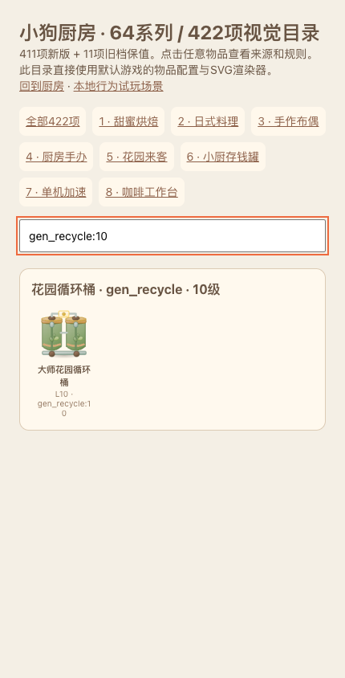

# 肥鹅公开证据对齐与63格迁移验收

2026-10-16。配置 `kitchen-feige-evidence-v2`，存档v4；基于PR #6已合入实现，并整合主分支 `ae84b44` 的已提交美术。保持厨房主题。没有合并本PR或部署生产。

## 结果与范围

- 主棋盘改为7列×9行，共63格。依据2022微信小游戏实机图，逐格人工复核；未宣称证明2026所有渠道布局。新增两行的空锁格与解锁价是D设计，沿用相邻合成清理。
- 五类主生产器的26个等级，逐字段采用2023-01-29原图中的周期、周期补量和总容量；这些是含加速价换算的历史玩家记录。其他设备/等级和所有掉率继续逐项标D。原图的总回满时间另行记录，未作为单周期照抄。
- 花树30分钟产1、缓冲2；垃圾袋8分钟产1、缓冲2；遗失物L5/L6为67/34分钟、缓冲4；储物柜L1手动6小时、L8自动32分钟、L11自动4分钟/缓冲6，均注明历史来源及冲突。
- 新猫窝改为12次耗尽消失，手环7次，NS仍按所选大陆墙壁路线3次。一级存钱罐使用后允许合并为未开启L2；已用L2的继承公式未知，继续禁止合并。紫剪刀支持最多20把同级叠加，失败不扣次数。
- 保留421个既有物品ID、资产键及最新main名称；新增 `gen_recycle:10`。64系列/422定义中411项为新版、11项为旧档兼容。这些计数描述本项目内容范围，不表示竞品逐项对应程度。

完整决策见 [逐字段对照](../../balance/ALIGNMENT_PARAMETERS.md) 和 [稳定ID/路线/美术清单](../../balance/ITEM_REFERENCE_MAP.md)，机器可读映射见 [JSON](../../balance/item-reference-map.json)。生成源为 `build_docs.py` 与 `align_feige.py`，运行数据与生成源一致。

## 研究取舍

[研究日志](research-log.json)保存检索范围、官方页版本、实际复核的原图URL与SHA-256。来源详细登记在[来源表](../../balance/SOURCES.md)。官方入驻页显示5.9.1和2026-06-03更新，页面没有公布全量参数；没有将历史数表标成现版官方数据。

原图G/H/K分别表示周期、周期内库存量、最大库存，I列估算回满时间。例如树的单周期30分钟、每周期1个、容量2，与文字记录的1小时回满相符。垃圾袋同理为8分钟/1个/容量2。工具箱L4的I列304分钟与G/H/K的152分钟/8件/20容量存在算式冲突；保留明确字段，运行时按离散批次调度，调度/满库暂停为D。

购物车2023文字中的28/14/7小时与原图周期/补量的回满尺度接近，2024攻略又写8/6小时。扫地机2024的9/10级与2023表也不同；本轮对该子系统采用同一组2023-01-29的逐周期字段，全部冲突写入决策，不拼成“2026统一表”。NS3/4次选择与本项目墙壁阶段路径一致的3次。包开锁仍D；图底1/2/4天属于存钱罐，语义未确认，未当作黑粉包解锁时长。

## 旧档权益

浏览器在替换活动档前保存原文和SHA-256；备份失败进入保护页。v3先验证49格、实例、配置和锁格，再按冻结PR #6规则结算已积累的离线时间。0—48位置不变，追加14个空锁格。超过新容量的库存转为溢出权益，当前周期剩余毫秒不折损，下一周期采用新规则。

余额、物品、次数、当前冷却、仓库/待领暂停、随机状态、订单和已领取奖励键均保留。旧永久猫窝保留原20补货/40库存/7200秒规则，支持重载和收纳；新猫窝为有限12次。没有无条件补发新玩家资产或重复奖励。v1/v2沿原保值路径直接迁入v4。冻结的真实PR #6测试档位于 `tests/fixtures/v3-49.json`。

## 验证

- 125项自动测试通过：42项历史引擎、80项当前引擎/对齐/迁移行为、3项摘要备份测试。完整日志：[tests.tap](tests.tap)。
- [运行时审计](runtime-audit.json)覆盖422定义的名称、等级、来源、SVG与真实合成/叠加行为；[静态审计](../../balance/VALIDATION.md)检查引用、概率归一和可达性。
- 最新main的421项SVG逐项SHA-256保持一致，测试以`ae84b44`快照为基准。新增循环桶L10扩展同一桶体，并加入仪表和脚轮；没有重绘既有1—9级。
- [浏览器结果](browser-results.json)覆盖390px移动端、320/430px响应布局、1440px桌面；真实点击生产、指针拖拽合成、交付、收纳、资源领取、重载、跨链和v3备份迁移。QA键与正常玩家键隔离，未记录页面脚本错误。
- 引擎回归覆盖第一/最后格、63越界、横向不跨行、底行锁格/相邻清理、满盘不扣费、库存/次数守恒、日周领取幂等和订单来源。

其他截图：[操作后重载](mobile-played.png)、[特殊路线](special-routes.png)、[v3迁移](v3-migration.png)、[桌面](desktop-63.png)。

## 供给与仍拟定的项目

[24小时供给模拟](supply-simulation.json)使用实际引擎，独立给每台设备100初始体力、自然120秒恢复，产物立即移出棋盘，无商店/免费礼包/付费补给，属于供给上界。每个来源分别占用全部体力，不能相加当作同一玩家的日供应。

| 首启用设备 | 本版24h点击上界 | 原D规则同条件 | 说明 |
| --- | --- | --- | --- |
| 厨具收纳缸L4 | 92 | 819 | 历史152分钟/8件/容量20，等待明显增加 |
| 烘焙原料罐L5 | 60 | 819 | 历史237分钟/8件/容量12 |
| 香草花盆L4 | 14 | 819 | 保留厨房启用档，按L6历史邻档拟定；4/5级仍D |
| 设备采购车L4 | 28 | 84 | 历史约424分钟/4件/容量16 |
| 花园循环桶L5 | 85 | 588 | 首档无表，按6级两倍周期拟定；仍D |

第一章八单只需5个烘焙一级等价，初始已有3件和12库存，未新增烘焙供给硬门槛；生鲜具体出货仍取决于D概率。花园猫窝的32个一级来客，在持续清空单台缓冲时至少需256分钟，另有上游合成、体力、空间等待。模拟不证明真实通关时长或留存。

仍D的关键项包括所有产物品类/等级概率、缺表的启用/最高等级和扩展档、厨房原创菜系/配方、100自然体力上限、免费休息次数、补能数量/每日次数、仓库6→60与价表、订单公式、升级经验和奖励、部分容器开锁/掉率、成熟/场景次数、剪刀边界及道具使用约束。官方2023新增饮品11级、测试5/6级的历史结构锚点继续保留；资源面值和包罐次数继续沿已登记的2023台服/大陆资料。测试通过只证明本项目按选择的配置执行。
