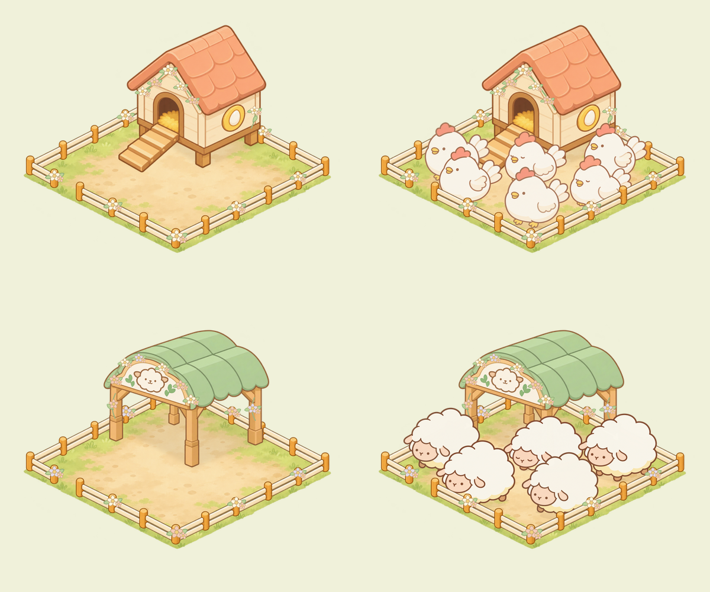
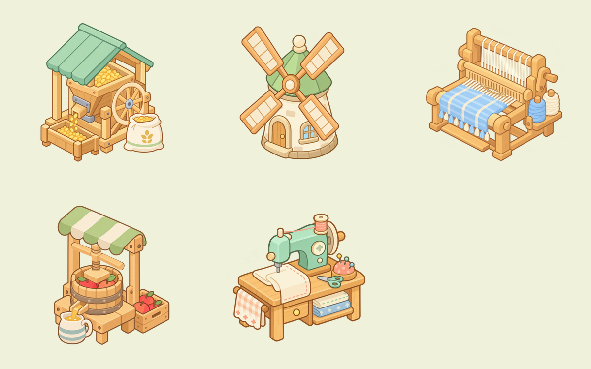

# 农场素材补全 · P0 / P1 / P2

基于 `de94fb3a5f71a4bda6cb92358aa0cd4571c1bdb6`（2026-10-28 的 main）。延续 `farm-priority-icons-v1` 与 `sumikko-farm-v1/shelter-layers-v2` 的暖色细描边、奶油色、柔和绿和桃橙色。所有旧文件保留；本包仅新增美术、源文件、交付元数据与独立预览，没有更改游戏运行时或部署。

## 交付范围

| 优先级 | 资源 | 交付 |
|---|---|---|
| P0 | 38 个加工商品 | 独立可编辑 SVG + 256×256 透明 PNG |
| P0 | 15 个材料/工具、6 个货币/奖励 | 独立可编辑 SVG + 256×256 透明 PNG |
| P1 | 10 组 × 铜/银/金，共 30 个成就徽章 | 三级有不同外轮廓和绶带，保留原 g01–g10 编号 |
| P1 | 首通、重玩、锁定、奖励暂存，共 4 个故事标识 | 独立 SVG + 透明 PNG |
| P1 | 花卉鸡舍、花卉绵羊棚 2 套 | 每套 3 个新增花饰层 + 5 个复用设施层，空栏/满栏图、SVG 与 ORA |
| P2 | 饲料机、风车、织布机、榨汁机、缝纫机 5 套 | 共 14 个独立透明 PNG 层、可编辑 SVG/ORA、循环参数和 60 张诊断相位图 |

总计 **93 个图标 + 2 套花卉栏舍 + 5 套可动机械**。图标 93 SVG/PNG 对；设施及机械的 PNG 分层合计 30 张（其中 10 张为原设施图层逐字节复用）。另有 7 个 ORA 文档。组合图、源图和诊断图不计作新增独立素材。

逐项对应文件见 [ASSET-LIST.csv](ASSET-LIST.csv)。元数据分别在 [icons-manifest.json](icons-manifest.json)、[skins-manifest.json](skins-manifest.json)、[machines-manifest.json](machines-manifest.json)。

## 预览

在本目录运行 `python3 -m http.server 64246 --bind 127.0.0.1`，打开 `http://127.0.0.1:64246/`。预览依赖本地 HTTP 加载 JSON；直接双击 HTML 的 `file:` 模式不适用。

- P0：所有图标、32px 检查、浅色与深草地底色。
- P1：徽章与故事状态、两套空栏/满栏组合图；满栏仍分别保留 6 只鸡、5 只绵羊。
- P2：五组动作可播放、暂停、拖动相位、单看活动部件；尊重系统减少动态效果设置。独立页面不导入游戏模块、不访问游戏存档。
- 静态联系图：`previews/p0-96.png`、`p0-32.png`、`p1-96.png`、`p1-32.png`、`floral-skins.png`、`machines.png`。




## 图标规格

SVG 128×128，PNG 256×256，暖棕线 `#9C7659`，圆角连接，统一 4px 安全边距。建议界面显示 32–64 CSS px；图标的数字、名称、价格、进度均由接入代码显示。每个 SVG 的部件组和路径均可编辑。

普通 UI 锚点为 `[64,64]`；可摆放的成就徽章另提供 `[64,112]`，与旧 64px 徽章的 `[32,56]` 对应。SVG 与 PNG 锚点需随尺寸等比缩放。

## 花卉栏舍组合

两套均保留 1200×1000 统一画布、`[600,590]` 共用锚点、零裁切偏移、4×4 占地、±0.5 地面轴和 v2 动物脚点。见各自 `layout.json`：地面占地、可站区域、入口、坡道、站立排除区、前栏遮挡边界和原始动物状态来源均有记录。

组合顺序：地面 → 建筑落地阴影 → 后栏 → 后栏花饰 → 建筑 → 屋檐花饰 → 独立动物/动物阴影 → 前栏 → 前栏花饰。源文件中没有画死动物。满栏图仅为摆放参考。

`layers/01-ground.png`、`02-building-shadow.png`、`03-rear-fence.png`、`04-building.png`、`07-front-fence.png` 都是 v2 原图的相同字节副本，只有 3 个花饰层是新增。不得把新层叠到已经画入完整院落的旧 `*_Floral.svg` 上，也不要再加第二块院落。建筑阴影只绘制一次。

`editable.svg` 保留花饰的矢量路径与建筑的嵌入位图；`editable.ora` 是可编辑的 PNG 图层文档，不宣称建筑为矢量。原动物三态和动画全部复用。

## 机械分层和动作

所有层统一 800×750，裁切偏移 `[0,0]`。原源图映射为 `scale: 0.5, offset: [72,75]`，每组的 `anchor` 从当前运行时的裁切区和 anchor 换算，**不是透明画布底部中心**。`legacyRegistration` 还记录原裁切框、显示宽度和换算后的整画布宽度；接入时让所有层共享同一变换。

| 机械 | 活动部件 | 周期 | 动作与遮挡 |
|---|---|---:|---|
| 饲料机 | 木制转轮 | 4.2 秒 | 在自己的正圆平面旋转，再用 `planeMatrix` 投影；前景立柱和粮袋遮住轮缘 |
| 风车 | 四片扇叶与轮毂 | 8.5 秒 | 四叶整体绕固定轮毂旋转，先旋转后投影；塔身保持静止 |
| 织布机 | 新增梭子 | 1.6 秒 | 沿织布平面来回，源图位移范围 210×105px（运行画布 105×52.5px）；侧架遮挡端部 |
| 榨汁机 | 压板 | 2.4 秒 | 源图竖向下压 20px（运行画布 10px），丝杆和手柄固定，桶前缘独立遮挡 |
| 缝纫机 | 机针与针夹 | 0.65 秒 | 源图竖向上提 28px（运行画布 14px），机头遮挡连接处 |

PNG 是静止相位的独立层；旋转部件另有 `sources/rotor-plane.png` 原平面图。**不要直接旋转已经投影的整画布 PNG**，应按 `manifest.json` 的局部支点与矩阵驱动原平面图。压板和机针做平移，不能移动整个建筑。

每组 `previews/phase-00.png` 至 `phase-11.png` 是 0/12…11/12 的诊断采样，`phases.png` 为联系图。它们不是固定 12fps 的成品动画帧，播放周期按上表；首帧没有被复制成末帧。编辑源图中保持独立底图、活动层、必要前景；机器没有新增烘焙地面阴影。

## 生成来源与可编辑源

- 图标及花饰：代码原生 SVG，延续已批准图标库；生成源 `source/build-icons.py`、`source/build-skins.py`。
- 机械：内置 Imagegen 共 7 次，用于 4 张去除活动部件的底图、2 张正面转子、1 张独立压板。全部原始生成文件保存在相应 `machines/*/sources/`，提示词见 [source/imagegen-prompts.json](source/imagegen-prompts.json)。原素材也保存在 `sources/original.png`。
- 图层提取、坐标投影、导出和诊断图由 `source/build-machines.cjs` 完成；梭子保留独立矢量源。SVG 的局部蒙版与变换均可编辑。
- 机械 `editable.svg` 和单层 SVG 引用同目录资源，请保留文件夹结构；ORA 已内嵌全部 PNG 图层。

## 再生成与检查

Python 3；PNG 导出用 Node + Sharp，验证需 Pillow。Sharp 不在默认搜索路径时，设置 `SHARP_MODULE` 为实际安装位置。

```sh
python3 source/build-icons.py
node source/export-icons.cjs
python3 source/build-skins.py
node source/export-skins.cjs
node source/build-machines.cjs
python3 source/package-ora.py
python3 source/verify-delivery.py
```

以上导出复用已保存的生成图，不会再次调用图像生成服务。图标源引用相邻 `farm-priority-icons-v1/source/build-icons.py`，花舍引用相邻 v2 原图；完整仓库内可复现。

验证结果见 [validation.json](validation.json) 和 [QA.md](QA.md)。本包尚未映射到正式运行时；接入、按需加载及正式设备性能验收另行进行。
